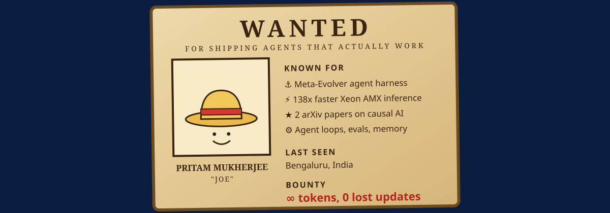

**Find me on LinkedIn: [linkedin.com/in/joe-mukherjee786](https://www.linkedin.com/in/joe-mukherjee786/)**

---

## ⚓ The Captain's Log

I build AI agents that actually work in production: harnesses, evals, memory and fast inference. Based in **Bengaluru, India**, currently at **Dotsin.ai x Assessli**, and open to new crews that take agent engineering seriously.

## 🧭 The Grand Line I sail

| 🏴‍☠️ Crew role | What I do there |
|---|---|
| **Agent harnesses** | [Meta-Evolver](https://github.com/JoeMukherjee/Meta-Evolver): an open-source, self-improving agent harness with loops, evals and a test suite behind it |
| **Inference and serving** | Intel Xeon AMX work with OpenVINO (BF16/INT8): latency from 1,260 ms to 9.1 ms |
| **Causal and behavioural AI** | Co-author of two arXiv papers: 2606.09672 and 2605.27580 |
| **AI backend systems** | FastAPI and TypeScript services, Kafka and Redis streams, Memgraph and Qdrant |

## 🗺️ Treasure map

## 📯 Set sail together

Hiring for agent, harness or LLM infrastructure work, or just want to talk loops, evals and memory? **[Send me a message on LinkedIn](https://www.linkedin.com/in/joe-mukherjee786/)**.

Original artwork, drawn for this profile. Fair winds. ⚓

